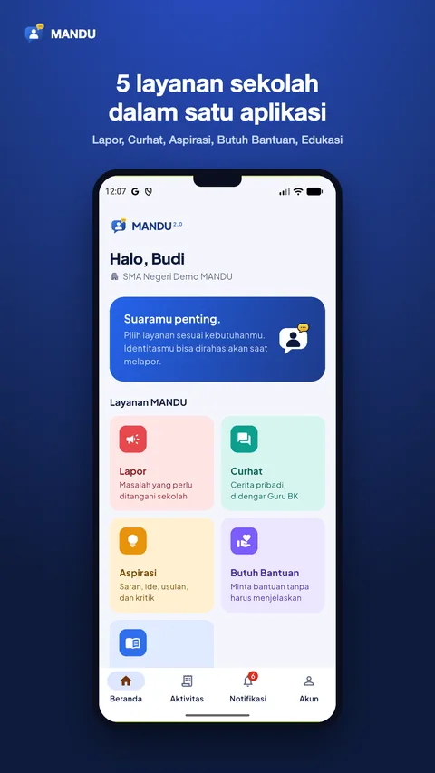
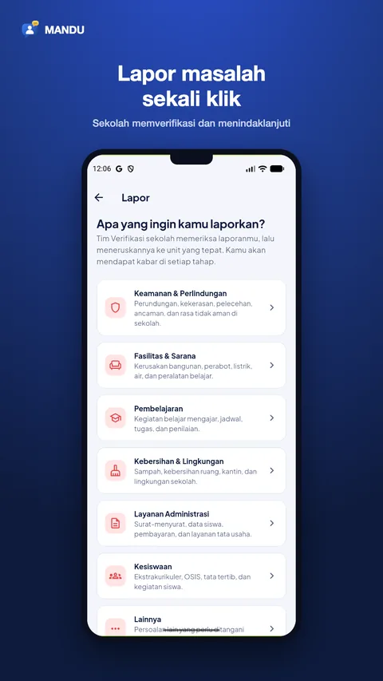
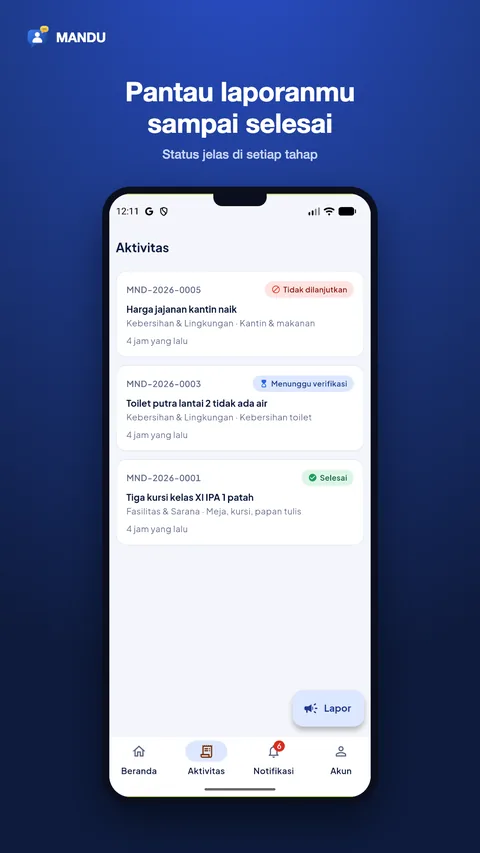
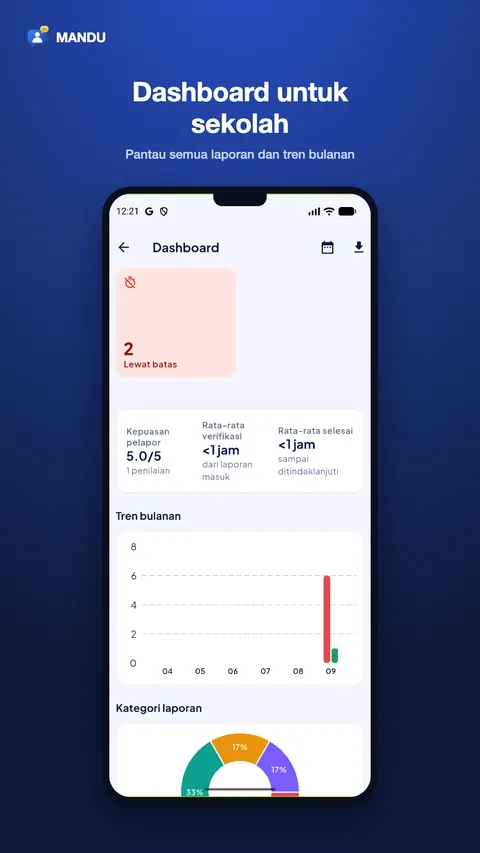
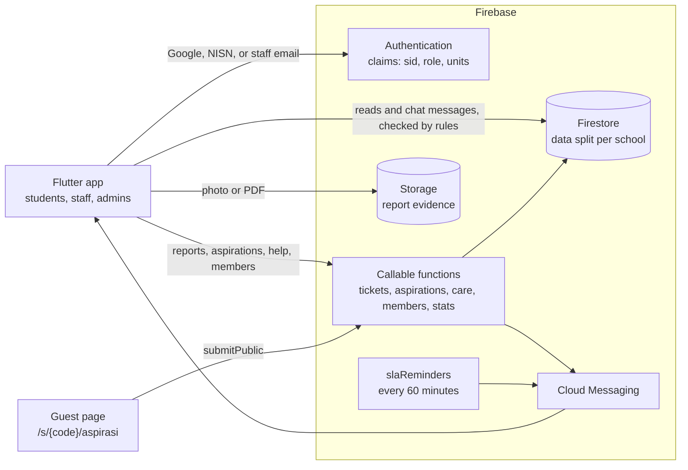

# MANDU (Teman Ngadu)

[](https://github.com/khrlanamm/mandu/actions/workflows/ci.yml)


School reporting and student support app, first built for SMA Negeri 1 Sukodadi and published by Komunitas Kertas Kosong. MANDU 2.0 serves many schools from one app. Each school joins with its own code, and its data stays separate from other schools.

[Google Play](https://play.google.com/store/apps/details?id=com.khrlanamm.mandu) | [Web dashboard](https://teman-ngadu.web.app)

## Screenshots

| Home | Report | Activity | School dashboard |
|---|---|---|---|
|  |  |  |  |

## Architecture



## Features

Five services for students:

- **Lapor (report).** Report bullying, violence, broken facilities, and other problems, with photo or PDF evidence. Each report gets a number (`MND-YYYY-NNNN`), an automatic priority, and a duplicate check. The verification team forwards it to the right unit, and the student follows every step. In confidential mode the reporter's identity is stored separately (`ticketOwners`) and no staff member can see it.
- **Curhat (talk).** Private real-time chat with a school counselor, under a pseudonym if the student wants. Only the student and that counselor can read it.
- **Aspirasi.** Suggestions and criticism for the school, also open to guests through `/s/{code}/aspirasi` without signing in. Profanity masking, rate limits per IP and per account, official replies, and one vote per student.
- **Butuh Bantuan (get help).** Request help with urgency and preferred contact time. A counselor picks it up and can continue in chat.
- **Edukasi.** Articles, links, and scholarship info from the platform and from each school, with search, bookmarks, and read counts.

For staff and admins:

- Roles: superadmin, school admin, principal, counselor, unit officer, and student, enforced with custom claims (`{sid, role, units[], canVerify}`) and security rules.
- Verification flow (forward, ask for details, reject), unit follow-up with internal notes, SLA deadlines with hourly reminders, and student ratings.
- School dashboard: report status and categories, monthly trend, unit performance, satisfaction, and CSV export. The superadmin sees platform totals only, never report content.
- Member management: student approval, staff invites, NISN import from CSV, and join codes with QR.

## Stack

- Flutter, Riverpod 3, go_router, freezed, fl_chart
- Firebase: Authentication (Google, NISN accounts, staff email), Firestore, Storage, Cloud Messaging, Hosting
- Cloud Functions in TypeScript (Node 22, firebase-functions v7), tested with Vitest against the Emulator Suite

The last Kotlin version lives on branch `kotlin-legacy`, tag `v3.0.0-kotlin`.

## Project layout

```
lib/
  app/         router, theme, emulator demo accounts
  core/        shared models, errors, utilities, widgets
  features/    auth, onboarding, home, lapor, aspirasi, care, edukasi, dashboard,
               members, school_admin, schools, superadmin, notifications, profile, account
functions/
  src/         callable and scheduled functions per domain (tickets, aspirations, care, ...)
  scripts/     seed, migration, and cleanup scripts
  test/        function and security rules tests
firestore.rules, storage.rules
docs/          progress notes, user manual, Play Console notes
```

## Running locally

Firebase config files are not committed. Generate them first:

```bash
flutter pub get
dart pub global activate flutterfire_cli
flutterfire configure --project=teman-ngadu --platforms=android \
  --android-package-name=com.khrlanamm.mandu --yes
```

Run against the Emulator Suite with demo data:

```bash
npm --prefix functions run build
firebase emulators:start --only auth,firestore,functions,storage --project teman-ngadu

# in another terminal: demo school, demo accounts, sample reports and content
cd functions && npm run seed:emulator

flutter run --dart-define=MANDU_EMULATOR=true
```

Emulator data is not kept. Run the seed again after every restart, and rebuild the functions after changing them.

Google Sign-In needs the SHA-1 and SHA-256 of the signing key registered in Firebase (Project settings, Your apps, Android). For the debug key on a new machine:

```bash
keytool -list -v -alias androiddebugkey -keystore ~/.android/debug.keystore -storepass android
firebase apps:android:sha:create 1:1073500398955:android:8abf2054efa290ea78182e <SHA> --project teman-ngadu
```

## Tests

```bash
flutter analyze && flutter test
cd functions && npm run test:emulator   # functions and security rules
```

## Release

1. Copy `android/key.properties.example` to `android/key.properties` and fill in the upload keystore path and passwords. Keep the keystore outside the repo.
2. Raise `version` in `pubspec.yaml`. The number after `+` is the versionCode.
3. Run `flutter build appbundle --release` and upload `build/app/outputs/bundle/release/app-release.aab`.

Play App Signing is on, and its key's SHA is registered in Firebase.

## License

All rights reserved. The source code is public for reference only. See [LICENSE](LICENSE).
